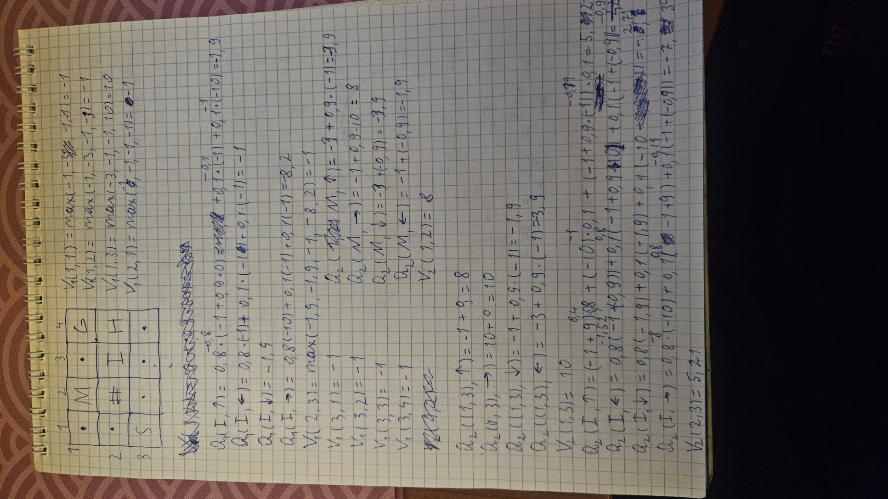
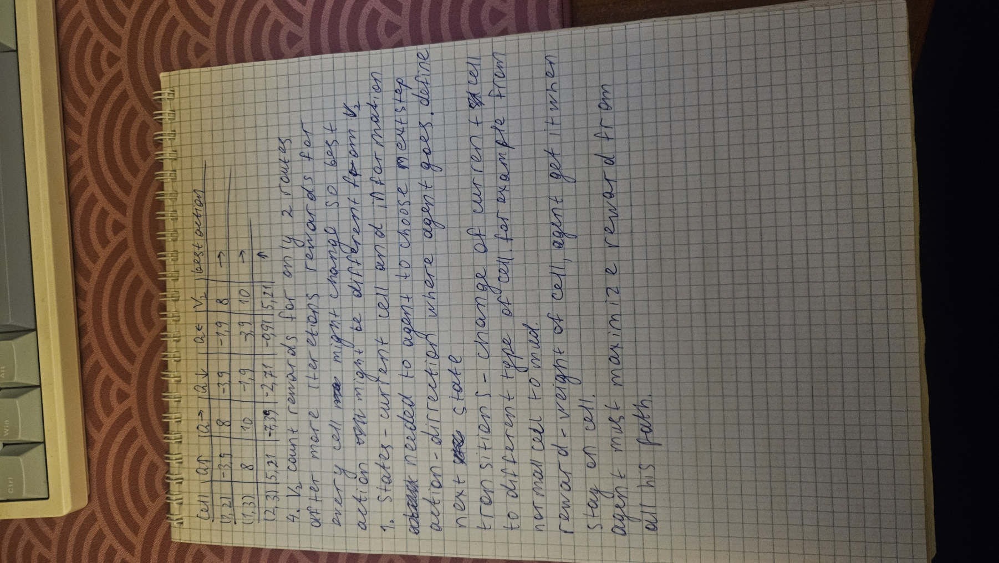

# HW6 submission

## AI-use declaration

ChatGPT/Codex was used to explain the Part A concepts and calculations, add the handwritten photographs, implement and run the Part B experiment and checks, implement the Part C transition model, value iteration, simulations and verification, and draft the results and explanations below. I supplied the Part B fixed-policy route and recovery rules. The reported numbers come from actual saved runs, not AI-generated estimates. The Part B strategy was not changed after seeing its results. Part C policies are computed from the specified reward objective.

## Setup and reproduction

Part B was run with Python 3.13.12, Gymnasium 1.4.0, NumPy 2.5.5, cloudpickle 3.1.3, typing_extensions 4.16.0, and Farama-Notifications 0.0.6. All installed dependencies are pinned in [requirements.txt](requirements.txt).

From the repository directory, using PowerShell:

```powershell
py -3.13 -m venv .venv
.\.venv\Scripts\python.exe -m pip install -r requirements.txt
.\.venv\Scripts\python.exe part_b.py
$env:PYTHONIOENCODING = 'utf-8'
.\.venv\Scripts\python.exe part_c.py
.\.venv\Scripts\python.exe -m unittest discover -s tests -v
```

The script writes results to `outputs/part_b/`. To rerun into a separate directory:

```powershell
.\.venv\Scripts\python.exe part_b.py --output-dir .venv\part_b_reproduction
```

References consulted: the official [FrozenLake documentation](https://gymnasium.farama.org/environments/toy_text/frozen_lake/) and [environment API](https://gymnasium.farama.org/api/env/).

Part C uses the same Python/NumPy environment and needs no new dependencies. Run `part_c.py` to print both maps, the rules, every iteration (including V0), final policies, and batch summaries. It writes results to `outputs/part_c/`. The transition model is in [grid_world.py](grid_world.py), the solver/simulator in [part_c.py](part_c.py), and the separate floor rules and maps in [data/maps.json](data/maps.json). The solver evaluates every possible action and its transition outcomes; it does not use a preselected route. For a separate reproduction run, use `.\.venv\Scripts\python.exe part_c.py --output-dir .venv\part_c_reproduction`.

## Part A — Paper calculations





## Part B — FrozenLake

### Fixed policy, written before the experiments

The following policy was written before running the experiments and stays unchanged in all conditions. Coordinates below start at 1; Gymnasium state IDs start at 0.

The intended route is down, down, right, down, right, right: states 0 -> 4 -> 8 -> 9 -> 13 -> 14 -> 15. On the top row, move left back toward the start. From state 10, move down rather than back to state 9; from state 6, also move down, continuing toward the bottom row. On the bottom row, move right toward the goal.

| State ID | Cell (row, column) | Action |
| --- | --- | --- |
| 0 | (1,1), start | down |
| 1 | (1,2) | left |
| 2 | (1,3) | left |
| 3 | (1,4) | left |
| 4 | (2,1) | down |
| 6 | (2,3) | down |
| 8 | (3,1) | right |
| 9 | (3,2) | down |
| 10 | (3,3) | down |
| 13 | (4,2) | right |
| 14 | (4,3) | right |

```text
D L L L
D H D H
R D D H
H R R G
```

The route takes six steps without slipping and avoids deliberately moving through state 6 between two holes. Boundaries can turn some slips into staying in place, but other slips can still reach holes. Recovery actions depend only on the current state, not on the history of the episode. The proposed success estimates of 10%, 20%, and 12% are initial hypotheses, not measured results or proven probabilities. These experiments evaluate this chosen policy; they do not establish that it maximizes success probability among all possible policies.

### Results

I ran `FrozenLake-v1`, `map_name="4x4"`, with its default rewards and slip probabilities. A goal gives 1; other moves and holes give 0. The four conditions combine random/fixed policies with `is_slippery=False/True`. Each condition has three batches of 50 episodes. For batch seeds 11, 22, and 33, episode `i` uses `reset(seed=1000 * batch_seed + i)`, for `i=0..49`. The same 150 episode seeds are used in every condition.

Random actions are drawn uniformly from 0, 1, 2, 3 with a separate `numpy.random.default_rng(episode_seed)` for each episode. This generator is independent of the environment's generator and uses the same seeding rule across conditions. The runner stops on termination, truncation, or 100 steps. On termination it checks the final tile for G/H before considering the time limit, including on step 100. Mean steps includes every episode in the batch, including failures.

| Slippery? | Policy | Batch seed | Goals /50 | Holes /50 | Time limits /50 | Success % | Mean steps |
| --- | --- | --- | --- | --- | --- | --- | --- |
| No | Random | 11 | 0 | 50 | 0 | 0 | 7.98 |
| No | Random | 22 | 0 | 50 | 0 | 0 | 6.42 |
| No | Random | 33 | 1 | 49 | 0 | 2 | 6.66 |
| No | Fixed | 11 | 50 | 0 | 0 | 100 | 6.00 |
| No | Fixed | 22 | 50 | 0 | 0 | 100 | 6.00 |
| No | Fixed | 33 | 50 | 0 | 0 | 100 | 6.00 |
| Yes | Random | 11 | 0 | 50 | 0 | 0 | 8.30 |
| Yes | Random | 22 | 2 | 48 | 0 | 4 | 7.76 |
| Yes | Random | 33 | 0 | 50 | 0 | 0 | 6.74 |
| Yes | Fixed | 11 | 1 | 49 | 0 | 2 | 5.22 |
| Yes | Fixed | 22 | 2 | 48 | 0 | 4 | 6.00 |
| Yes | Fixed | 33 | 1 | 49 | 0 | 2 | 5.14 |

Across all three batches, deterministic random achieved 1/150 goals (0.67%), deterministic fixed 150/150 (100%), slippery random 2/150 (1.33%), and slippery fixed 4/150 (2.67%). Their pooled mean episode lengths were 7.02, 6.00, 7.60, and 5.45 steps, respectively. No time limits occurred in any of the 600 episodes. No failure occurred for the deterministic fixed policy; both goals and holes occurred in each other condition.

#### Saved evidence

- [All 600 episode rows](outputs/part_b/episodes.csv), including the final state, policy, condition, seeds, steps, total reward, and outcome.
- [All 12 batch summaries](outputs/part_b/summary.csv).
- [Versions, map, policy, seed scheme, and validation checks](outputs/part_b/metadata.json).
- [Trace index](outputs/part_b/trace_index.json), identifying the first observed example of every outcome in each condition.
- Deterministic random: [goal](outputs/part_b/traces/deterministic_random_goal.txt) and [hole](outputs/part_b/traces/deterministic_random_hole.txt).
- Deterministic fixed: [goal in six steps](outputs/part_b/traces/deterministic_fixed_goal.txt); no failed episode was observed.
- Slippery random: [goal](outputs/part_b/traces/slippery_random_goal.txt) and [hole](outputs/part_b/traces/slippery_random_hole.txt).
- Slippery fixed: [goal](outputs/part_b/traces/slippery_fixed_goal.txt) and [hole](outputs/part_b/traces/slippery_fixed_hole.txt).

Each trace includes Gymnasium's text rendering, selected actions, state transitions, rewards, and termination/truncation flags. State IDs in the step records identify the agent's position after ANSI color codes are removed.

#### Effect of slipping and the route hypothesis

Without slipping, the fixed policy follows the chosen six-step route and always succeeds in these runs. With slipping, its success falls to 2.67%. Being next to a boundary prevents some displacements but does not eliminate nearby holes. For example, at state 4, choosing down can move right into hole 5 with probability 1/3. At state 8, choosing right can move down into hole 12 with probability 1/3. At state 10, choosing down can move right into hole 11. Trying to recover from state 6 by moving down has two dangerous perpendicular outcomes, holes 5 and 7.

The initial 20% estimate for the lower route was not supported by these 150 slippery fixed-policy episodes. Counting dangerous neighboring cells or only direct routes does not account for all repeated visits, boundary stays, and failed recovery attempts. The proposed upper route and the claimed 10%/12% probabilities were not separately tested, so this experiment cannot confirm those numbers or prove that the chosen policy is optimal. The policy was kept unchanged despite its low measured success.

For uniformly random actions, success remains low in both modes. The observed change from 1 to 2 successes is too small to demonstrate that slipping improves random behavior. With uniform actions and the default symmetric slipping, each actual direction is still selected with marginal probability 1/4; individual sampled trajectories can nevertheless differ.

#### Batch variation and sufficient evidence

The deterministic fixed batches agree exactly: 100% success and six steps each. Random deterministic success rates are 0%, 0%, and 2%; random slippery rates are 0%, 4%, and 0%; fixed slippery rates are 2%, 4%, and 2%. With only 50 episodes per batch, one extra goal changes the rate by two percentage points. The few successes in slippery conditions do not support a precise population success estimate or a strong claim that fixed is better than random there.

A successful trace demonstrates possibility, not reliability. For example, slippery fixed seed 11020 reaches the goal in 14 steps, but 146 of its 150 episodes end in holes. Slippery fixed seed 11000 slips from the start to state 1, eventually returns to the start, then later slips from state 4 into hole 5 on step 8. Its shorter overall mean length reflects frequent early failures, not a faster successful route.

#### Why this is not training

The fixed state-to-action table never changes, and the random policy always samples uniformly. There are no reward-based parameter updates, learned Q-values, or policy improvements between episodes. Repeated episodes estimate the performance of these predefined policies under different dynamics; they do not train an agent.

#### Verification

All four tests passed: the actual deterministic route reaches the goal in six steps; goal and hole outcomes take priority over simultaneous truncation on step 100; and a nonterminal episode at the limit is recorded as a time limit. The runner also checks 600 rows, 12 batches, matching episode seed lists, valid step/reward/outcome combinations, and all 150 six-step deterministic fixed successes. A second complete run produced identical SHA256 hashes for all 11 result files, including seven traces.

## Part C — Custom solver

### Maps, rules and objective

```text
Original       Extended
.M.G           .M.G
.#IH           .#IH
S...           SD.W
```

Coordinates start at 1. All traversable cells are states; the wall is excluded. Actions are up, right, down and left. Rewards depend on the destination: S/ordinary floor/ice = -1, mud = -3, sand = -2, water = -5, goal = +10, hole = -10. Goal and hole end the episode, have value zero, and provide no subsequent rewards. There is no extra floor cost on entry to goal/hole.

Movement from S, ordinary floor, mud, sand and water is deterministic. Only movement starting on ice slips: 0.8 in the intended direction and 0.1 in each perpendicular direction. Each branch is resolved separately; a wall/boundary leaves the agent in place and pays the reward of the cell where it remains. Entering ice from ordinary floor is deterministic. See the saved [full rules](outputs/part_c/rules.md) and complete transition tables for the [original](outputs/part_c/paper_map/transitions.csv) and [extended](outputs/part_c/extended_map/transitions.csv) maps.

The assignment maximizes expected discounted reward, not goal probability alone. The synchronous update is `V_new(s) = max_a sum P(s'|s,a) * [R(s,a,s') + 0.9*V_old(s')]`, with V0 = 0. Every state/action/outcome is considered at every update. Enumerating all complete paths is impossible because repeated slips and cycles allow infinitely many trajectories. Value iteration accounts for their discounted consequences through repeated Bellman updates. Goal probability and expected termination time are evaluated separately by solving the fixed-policy transition equations.

### Compare code with paper

The original map's computed V1 is:

```text
 -1   -1   10   G:0
 -1    #   -1   H:0
 -1   -1   -1    -1
```

Using only V1, the requested second-round calculations are:

| Cell | Q(up) | Q(right) | Q(down) | Q(left) | V2 | Best action |
| --- | --- | --- | --- | --- | --- | --- |
| (1,2) | -3.90 | 8.00 | -3.90 | -1.90 | 8.00 | right |
| (1,3) | 8.00 | 10.00 | -1.90 | -3.90 | 10.00 | right |
| (2,3) | 5.21 | -7.39 | -2.71 | -0.91 | 5.21 | up |

These V1/V2 results agree with the Part A calculations. One handwritten first-round ice/right calculation appears to omit the minus sign in its final result: `0.8*(-10)+0.1*(-1)+0.1*(-1)` is **-8.2**, not +8.2; the handwritten maximum already uses -8.2, so V1 is unaffected. The correct signed calculation is used by the model. See [all requested V2 action values](outputs/part_c/paper_map/paper_comparison.csv) and the [full original iteration log](outputs/part_c/paper_map/iterations.txt).

### Values, policies and convergence

The solver stops only after a full update with maximum absolute change below 0.000001. The safeguard is 10,000 updates; reaching it without satisfying the tolerance is explicitly reported as nonconvergence. V0 is logged but is not counted as an update.

| Map | Updates | Final maximum change | Converged? | V(start) |
| --- | --- | --- | --- | --- |
| Original | 12 | 2.16529310482e-7 | Yes | 1.535824154 |
| Extended | 11 | 2.40588123201e-7 | Yes | 1.502000000 |

The final Bellman residuals are 1.94876386139e-8 and 2.16529314478e-8. Dividing by `1-gamma` gives value-error bounds below 2.2e-7. A direct fixed-policy linear-system evaluation independently agrees with the converged values within tolerance.

Original final values and policy:

```text
 4.200000   8.000000  10.000000   0.000000
 2.780000       #      5.824176   0.000000
 1.535824   2.817582   4.241758   2.817582

 →  →  →  G
 ↑  #  ↑  H
 →  →  ↑  ←
```

Extended final values and policy:

```text
 4.200000   8.000000  10.000000   0.000000
 2.780000       #      5.824176   0.000000
 1.502000   2.817582   4.241758   2.817582

 →  →  →  G
 ↑  #  ↑  H
 ↑  →  ↑  ←
```

Policies are extracted by recomputing all action scores using final values. Numerical ties within 1e-12 are resolved in the order up, right, down, left. There are no tied final best actions in either map.

- Original: every iteration in [text](outputs/part_c/paper_map/iterations.txt) and [CSV](outputs/part_c/paper_map/iterations.csv); [final values](outputs/part_c/paper_map/values.txt), [policy arrows](outputs/part_c/paper_map/policy.txt), [all final Q-values](outputs/part_c/paper_map/final_q.csv), [convergence](outputs/part_c/paper_map/convergence.json), [policy probabilities and expected steps from every state](outputs/part_c/paper_map/policy_evaluation.csv).
- Extended: every iteration in [text](outputs/part_c/extended_map/iterations.txt) and [CSV](outputs/part_c/extended_map/iterations.csv); [final values](outputs/part_c/extended_map/values.txt), [policy arrows](outputs/part_c/extended_map/policy.txt), [all final Q-values](outputs/part_c/extended_map/final_q.csv), [convergence](outputs/part_c/extended_map/convergence.json), [policy probabilities and expected steps from every state](outputs/part_c/extended_map/policy_evaluation.csv).

#### Reward versus probability of reaching the goal

On the original map the intended reward-optimal route is `(3,1) -> (3,2) -> (3,3) -> (2,3) -> (1,3) -> (1,4)`, with directions right, right, up, up, right. Actual trajectories can stay on ice or enter the hole. Its expected discounted return is **1.535824176**, goal probability **8/9 = 88.8889%**, and hole probability **1/9**. Termination occurs with probability 1 and expected length is five steps. At the ice tile, repeated wall stays explain the eventual goal probability: `0.8/(0.8+0.1) = 8/9`.

The safe upper route is `(3,1) -> (2,1) -> (1,1) -> (1,2) -> (1,3) -> (1,4)`, with directions up, up, right, right, right. It reaches the goal deterministically in five steps and has discounted return `-1 - 0.9 - 3*0.9^2 - 0.9^3 + 10*0.9^4 = 1.502`. This achieves the maximum possible goal probability, 100%, but its reward is slightly lower than the original reward-optimal policy. The original map therefore demonstrates a conflict between the two criteria; maximizing goal probability cannot be silently substituted for the assignment's reward objective.

On the extended map, the reward-optimal policy takes that safe upper route, giving both return **1.502** and **100%** goal probability. Comparisons are saved for the [original](outputs/part_c/paper_map/route_comparison.json) and [extended](outputs/part_c/extended_map/route_comparison.json) maps. These describe intended paths plus exact model-based policy evaluations, not exhaustive lists of stochastic trajectories.

### Simulation results

I used a custom simulator, with three batches of 50 episodes per map, batch seeds 11/22/33, episode seed `1000*batch_seed+i`, and a 100-step limit. `random.Random(episode_seed)` draws one transition sample per step. Both maps use the same episode seed lists. A terminal result on step 100 takes priority over the time limit. Returns use `r0 + 0.9*r1 + 0.9^2*r2 + ...`.

| Map | Batch seed | Goals /50 | Holes /50 | Time limits /50 | Mean steps | Mean discounted return |
| --- | --- | --- | --- | --- | --- | --- |
| Original | 11 | 42 | 8 | 0 | 4.98 | 0.891260 |
| Original | 22 | 46 | 4 | 0 | 5.04 | 1.914776 |
| Original | 33 | 48 | 2 | 0 | 5.04 | 2.492144 |
| Extended | 11 | 50 | 0 | 0 | 5.00 | 1.502000 |
| Extended | 22 | 50 | 0 | 0 | 5.00 | 1.502000 |
| Extended | 33 | 50 | 0 | 0 | 5.00 | 1.502000 |

Original totals: 136/150 goals (90.67%), 14 holes, no time limits, mean length 5.02, mean discounted return 1.766060. Extended totals: 150/150 goals, no holes/time limits, mean length 5, mean return 1.502000.

Saved evidence: [six batch summaries](outputs/part_c/summary.csv), original [episode results](outputs/part_c/paper_map/episodes.csv) and [every simulated transition](outputs/part_c/paper_map/episode_steps.csv), extended [episode results](outputs/part_c/extended_map/episodes.csv) and [every simulated transition](outputs/part_c/extended_map/episode_steps.csv), and [run configuration/versions](outputs/part_c/metadata.json).

### Explain your results

**Changed values and actions.** The start changes from approximately 1.535824 to 1.502000, and its best action changes from right to up. Other states have the same limiting optimal values and actions; tiny CSV differences below the convergence tolerance come from stopping after different numbers of updates. See the [cell-by-cell comparison](outputs/part_c/map_comparison.csv).

**Floor costs.** On the original map, going right from the start is slightly better than going up: Q(right) is approximately 1.535824 versus Q(up)=1.502. On the extended map, entering sand adds one extra unit of immediate cost, making Q(right) approximately 0.535824; Q(up) stays 1.502, so the start action switches. Water is not entered on either optimal route from the start. From (3,3), moving right into (3,4) becomes four units more expensive, reinforcing avoidance of that direction. The value of a sand/water cell need not decrease just because its entry reward is worse: an agent already standing there can leave deterministically, and the next destination determines its next reward. Thus values at (3,2) and (3,4) remain approximately 2.817582.

**Ice and risk.** From ice, both policies select up. At final values on the original map its Q(up) is approximately 5.824176, compared with Q(right)=-6.918242, Q(down)=1.678242, Q(left)=4.475165. The original start route accepts the ice risk for a small reward advantage over paying for mud. The extended start route avoids ice, but the policy still specifies up if the agent were placed on it. In both policies, termination has probability 1 from every nonterminal cell according to the model-based evaluation; termination can mean either goal or hole.

**Finite simulations and infinite-horizon values.** V(start) is an expected infinite-horizon discounted return, whereas the reported simulation mean is a random sample average truncated at 100 steps. The original map's sampled return 1.766060 differs from V(start) approximately 1.535824 because the sample contains fewer holes than the model's expected fraction; batch return means also vary noticeably. This does not invalidate the Bellman calculation. In general, a time limit also removes rewards beyond step 100. With absolute rewards at most 10 and gamma=0.9, the absolute omitted tail is bounded by `10*0.9^100/(1-0.9)`, approximately 0.002656 per episode. No sampled episode reached that limit here. The extended route is deterministic and finishes in five steps, so its sample mean matches its value up to floating-point rounding.

### Rule checks

All 16 original-map and 14 extended-map rule/value checks passed. Detailed evidence: [original checks](outputs/part_c/paper_map/rule_checks.json) and [extended checks](outputs/part_c/extended_map/rule_checks.json).

The checks show that (2,2) is not a state; moving up from (1,1) stays there with reward -1; moving down from mud (1,2) into the wall stays in mud with reward -3; ice/up gives 0.8 to (1,3), 0.1 to the wall/stay, and 0.1 to the hole; every state/action has probabilities summing to 1; entering ice from floor is deterministic; entering mud/sand/water pays -3/-2/-5; blocked stays on sand/water pay their respective costs; entering goal/hole pays +10/-10; and all actions after termination pay zero. Final terminal values remain zero.

The full test suite has 10 passing tests (four Part B and six Part C). Part C tests cover both maps, the early nonconvergence safeguard, synchronous updates, adding an arbitrary deterministic floor rule without solver changes, the distinction between reward and success objectives, goal arrival exactly on step 100, and a genuine nonterminal time limit. Fixed-policy values are independently checked using linear systems rather than another value-iteration implementation.

A separate complete reproduction run produced identical SHA256 hashes for all 31 generated Part C files. An independent CSV audit recomputed total and discounted rewards from the saved steps of all 300 episodes, checked all six batch summaries and seed lists, verified that every V0-to-final iteration was recorded, and confirmed that all local report links resolve.

